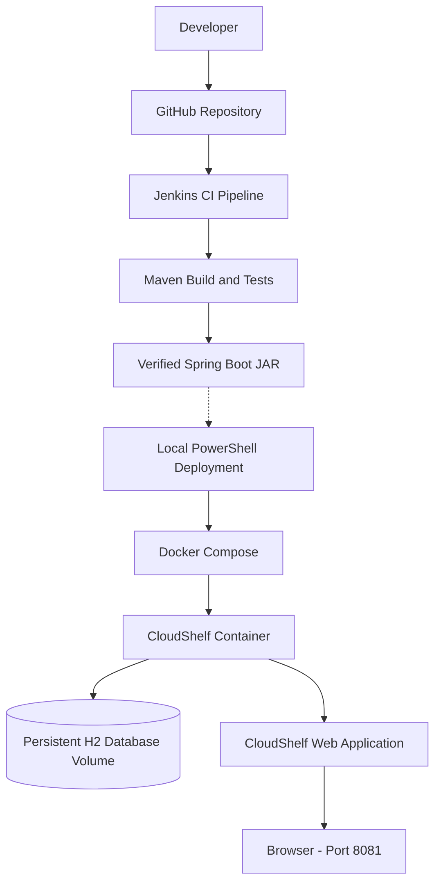

# 📚 CloudShelf — Smart Library Management System

CloudShelf is a web-based Library Management System developed using Java, Spring Boot, Thymeleaf, and H2 Database.

The project demonstrates DevOps practices using GitHub, Maven, Jenkins, Docker, and Docker Compose.

It supports library operations such as managing books, registering members, issuing and returning books, and tracking overdue loans.

---

## 🚀 Features

- Interactive library dashboard
- Books management (Add, View, Update, Delete)
- Members management
- Book issue and return management
- Book availability tracking
- Due-date and overdue tracking
- Persistent H2 database storage
- Docker containerization
- Jenkins CI pipeline
- Automated Maven build and testing
- PowerShell-based local Docker deployment

---

## 🛠 Technology Stack

| Technology | Purpose |
|------------|---------|
| Java 21 | Backend programming |
| Spring Boot 4.0.10 | Application framework |
| Spring MVC | Web application architecture |
| Thymeleaf | Dynamic HTML templates |
| HTML & CSS | Frontend interface |
| Spring Data JPA | Database operations |
| H2 Database | Persistent database |
| Maven | Build and dependency management |
| Git & GitHub | Version control |
| Jenkins | Continuous Integration |
| Docker | Application containerization |
| Docker Compose | Container deployment |
| PowerShell | Local deployment automation |

---

## 🏗 DevOps Architecture



The dotted arrow represents the separately triggered local deployment process. Jenkins currently handles CI, while the PowerShell script handles deployment.

---

## 🔄 CI/CD Workflow

### Continuous Integration — Jenkins

1. Developer maintains source code in GitHub.
2. Jenkins checks out the latest code from the `main` branch.
3. Jenkins verifies Java and Maven installations.
4. Maven compiles the application.
5. Automated tests are executed.
6. A Spring Boot executable JAR is generated.
7. Jenkins verifies the generated JAR.

### Local Deployment — Docker

1. Run the PowerShell deployment script.
2. Verify Docker Desktop is available.
3. Check the existing persistent database volume.
4. Execute Maven build and tests.
5. Build the Docker image.
6. Deploy the application using Docker Compose.
7. Access CloudShelf in the browser.

**Current status:** Continuous Integration and repeatable local deployment are implemented. Automatic deployment after each GitHub push is not yet configured.

---

## 📂 Project Structure

```text
CloudShelf/
│
├── .mvn/
│
├── src/
│   ├── main/
│   │   ├── java/
│   │   └── resources/
│   │       ├── templates/
│   │       ├── static/
│   │       └── application.properties
│   │
│   └── test/
│
├── .dockerignore
├── .gitignore
├── Dockerfile
├── docker-compose.yml
├── Jenkinsfile
├── deploy.ps1
├── mvnw
├── mvnw.cmd
├── pom.xml
└── README.md
```

---

## 💻 Run CloudShelf Locally

### Prerequisites

Install the following:

- Java 21
- Git
- Docker Desktop
- Maven (optional, because the Maven wrapper is included)

### Step 1 — Clone Repository

```bash
git clone https://github.com/Asr1403/CloudShelf.git
cd CloudShelf
```

### Step 2 — Build Application

On Windows PowerShell:

```powershell
.\mvnw.cmd clean verify
```

### Step 3 — Run Spring Boot

```powershell
.\mvnw.cmd spring-boot:run
```

Open:

http://localhost:8081

Stop the local application before starting the Docker version because both use port 8081.

---

## 🐳 Docker Deployment

### Step 1 — Build the Application

```powershell
.\mvnw.cmd clean verify
```

### Step 2 — Start Docker Desktop

Ensure Docker Desktop is running.

### Step 3 — Build and Run Container

```powershell
docker compose up -d --build
```

### Step 4 — Check Running Containers

```powershell
docker ps
```

### Step 5 — Open CloudShelf

http://localhost:8081

### Step 6 — View Container Logs

```powershell
docker logs online-library-container
```

---

## ⚙️ PowerShell Deployment Automation

CloudShelf includes a local deployment script named:

`deploy.ps1`

The script performs:

- Docker availability verification
- Persistent database volume verification
- Maven build and tests
- Docker image rebuilding
- Container deployment
- Container status checking

### Run Deployment Script

```powershell
powershell.exe -NoProfile -ExecutionPolicy Bypass -File .\deploy.ps1
```

**Important:** The deployment script requires the existing Docker volume named `online-library_library-data`. For a first-time installation, initialize the application using the Docker deployment steps above.

---

## 💾 Database Persistence

CloudShelf uses H2 Database with Docker named-volume persistence.

Database path inside the container:

```text
/app/data/librarydb
```

Docker volume:

```text
online-library_library-data
```

This allows application data to survive container recreation.

### Verify Database Volume

```powershell
docker volume ls
```

### Verify Container Mount

```powershell
docker inspect online-library-container --format '{{range .Mounts}}{{println .Name .Destination}}{{end}}'
```

Expected output:

```text
online-library_library-data /app/data
```

**Warning:** Do not run `docker compose down -v` or delete the database volume unless you intentionally want to remove the stored data.

---

## 🔧 Jenkins CI Pipeline

CloudShelf uses a Jenkins Pipeline configured with its GitHub repository.

Repository:

https://github.com/Asr1403/CloudShelf

Branch:

`main`

Pipeline file:

`Jenkinsfile`

### Jenkins Pipeline Stages

| Stage | Description |
|-------|-------------|
| Checkout | Download source code from GitHub |
| Verify Environment | Check Java and Maven |
| Build and Test | Run Maven build and automated tests |
| Verify JAR | Verify executable Spring Boot JAR |

### Maven Build Command

```bash
mvn -B clean verify
```

### Expected Output

```text
BUILD SUCCESS
CloudShelf CI build and tests passed!
Finished: SUCCESS
```

The Jenkins CI pipeline has been successfully tested.

---

## 🌐 Application URLs

| Service | URL |
|---------|-----|
| CloudShelf Dashboard | http://localhost:8081 |
| Books Management | http://localhost:8081/books |
| Members Management | http://localhost:8081/members |
| Loan Management | http://localhost:8081/loans |
| Jenkins Dashboard | http://localhost:8080 |

These URLs are for local development.

---

## 🧪 Testing and Verification

The following operations have been verified:

- Maven build completes successfully
- Spring Boot application starts
- Jenkins retrieves the latest GitHub code
- Jenkins executes automated tests
- Executable JAR is generated
- Docker container starts successfully
- Application opens in the browser
- Database records remain available after Docker redeployment

---

## 📌 Future Enhancements

- Automatic deployment triggered by successful Jenkins builds
- Role-based authentication and authorization
- PostgreSQL or MySQL integration
- REST API development
- Automated integration testing
- Monitoring and application health checks
- Cloud deployment on Azure or AWS
- Automated database backups

---

## 📖 Project Information

**Project Name:** CloudShelf — Smart Library Management System

**Project Type:** Full-Stack Web Application with DevOps Integration

**Version Control:** GitHub

**CI Tool:** Jenkins

**Container Platform:** Docker

**Deployment:** Local Windows PowerShell and Docker Compose

---

## 👨‍💻 Author

**Ayush Singh**

B.Tech — Computer Science and Engineering

GitHub: https://github.com/Asr1403

---

## ⭐ Project Repository

https://github.com/Asr1403/CloudShelf
